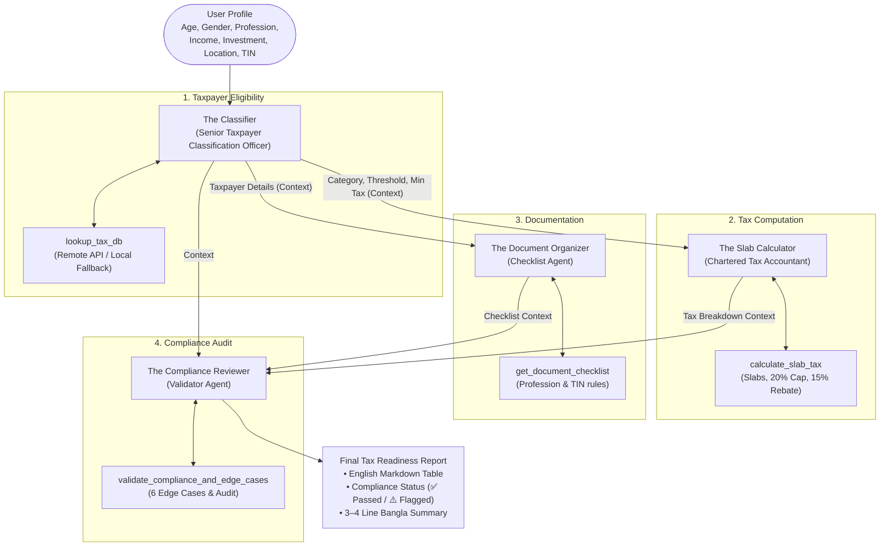

# 🇧🇩 "Amar Tax" AI Agent - Virtual Tax Advisor

[](https://colab.research.google.com/drive/1UfgNv61I-ICv6S-iWflV8yC0FJtt1HLq)
[](https://github.com/Udipto-Mondal/Amar-Tax-AI-Agent.git)
[](https://www.python.org/)
[](https://github.com/crewAIInc/crewAI)
[](LICENSE)

An intermediate-level **Applied AI Multi-Agent System (MAS)** built with **CrewAI** that serves as an autonomous **"Virtual Tax Advisor"** for individual income tax filing in Bangladesh. 

The system takes a taxpayer's personal profile (*Age, Gender, Profession, Income, Investment, Location, TIN status*) and produces a comprehensive **Tax Readiness Report** comprising an **English Markdown Table**, **Compliance Audit Flags**, and a **3–4 line natural Bangla summary**.

---

## 📑 Table of Contents
- [Project Overview](#-project-overview)
- [System Architecture & Workflow](#-system-architecture--workflow)
- [The Crew Definition (4 Specialized Agents)](#-the-crew-definition-4-specialized-agents)
- [Technical Requirements Matrix](#-technical-requirements-matrix)
- [Key Assumptions Made](#-key-assumptions-made)
- [Error Handling & Edge Cases](#-error-handling--edge-cases)
- [Project Structure](#-project-structure)
- [Installation & Local Setup](#-installation--local-setup)
- [Running the Project](#-running-the-project)
- [Google Colab Instructions](#-google-colab-instructions)
- [Test Cases & Expected Behavior](#-test-cases--expected-behavior)
- [Video Demonstration Guide (3–5 min script)](#-video-demonstration-guide-35-min-script)

---

## 🎯 Project Overview
Filing an individual income tax return in Bangladesh is often daunting:
- Who is legally required to file?
- What is the tax-free threshold for my demographic?
- How is the progressive slab tax computed?
- How is the investment rebate calculated and capped?
- What certificates and documentation are required for my profession?

**Amar Tax** solves this by orchestrating 4 collaborative AI agents that specialize in tax law classification, mathematical slab calculations, documentation compliance, and final audit verification.

---

## 🔄 System Architecture & Workflow

The orchestration pattern follows:
$$\text{User Profile} \longrightarrow \text{Classifier} \longrightarrow \text{Calculator} \longrightarrow \text{Organizer} \longrightarrow \text{Reviewer} \longrightarrow \text{Report}$$



---

## 👥 The Crew Definition (4 Specialized Agents)

Every agent possesses a dedicated role, concrete goal, rich backstory, and customized tool set:

### 1. The Classifier (Taxpayer Eligibility Agent)
- **Role**: `Senior Taxpayer Classification Officer`
- **Goal**: Based on the user's profile, determine:
  - Whether filing a return is mandatory
  - Taxpayer category (`General`, `Female`, `Senior 65+`, `Disabled`, `Freedom Fighter`)
  - The tax-free threshold for that category
  - The minimum tax based on location
- **Backstory**: A 15-year veteran at the National Board of Revenue (NBR) with exhaustive expertise in individual taxpayer categorization and regional minimum tax jurisdictions. Meticulously enforcer of legal age restrictions—anyone under 18 attempting independent filing is immediately flagged.
- **Tools**: `lookup_tax_db`

### 2. The Slab Calculator (Tax Computation Agent)
- **Role**: `Chartered Tax Accountant`
- **Goal**: Using the Classifier's output as context, accurately calculate:
  - Total tax according to slabs
  - Allowable investment and investment rebate (15% of allowable investment capped at 20% of income)
  - Net payable tax (compared against minimum tax)
- **Constraint**: *Use only the slab and rebate rules from the Local DB. Never invent rates.*
- **Backstory**: An elite Fellow Chartered Accountant (FCA) with decades of practical tax computation experience under Bangladesh tax law. Renowned for arithmetic perfection and strict adherence to statutory tax slabs and investment credit caps.
- **Tools**: `lookup_tax_db`, `calculate_slab_tax`

### 3. The Document Organizer (Checklist Agent)
- **Role**: `Return Filing Documentation Officer`
- **Goal**: Generate a customized checklist based on profession and income sources (e.g., *Salaried → Salary Certificate, Freelancer → Remittance Proof, Landlord → Rent Agreement, Investor → Investment Certificates*).
- **Rule**: If the taxpayer does not have a TIN, `TIN Registration` is mandated at the very top. If profession is unlisted in DB, safely falls back to the general checklist.
- **Backstory**: An experienced officer at the NBR Central Service Center dedicated to ensuring taxpayers submit all necessary legal certificates to avoid penalties or audit scrutiny.
- **Tools**: `get_document_checklist`

### 4. The Compliance Reviewer (Validator Agent) ⭐ Intermediate Requirement
- **Role**: `Compliance & Audit Reviewer`
- **Goal**: Cross-check the outputs of the other three agents, catch inconsistencies, evaluate edge cases, and assign a final status of `✅ Passed` or `⚠️ Flagged` in the report.
- **Output**: English Markdown Table + a 3–4 line natural Bangla summary.
- **Backstory**: Chief Compliance & Audit Reviewer at the NBR. Possesses an eagle eye for computational discrepancies, contradictory declarations, and statutory oversights. Synthesizes findings into an executive report with an empathetic Bangla summary.
- **Tools**: `validate_compliance_and_edge_cases`

---

## 📊 Technical Requirements Matrix

| # | Technical Requirement | Assignment Specification | Implementation Details in Amar Tax |
|---|---|---|---|
| **1** | **Agent Persona** | Every agent must have a role, goal, and backstory. | Implemented in `src/agents.py` with 4 complete personas adhering strictly to the PDF. |
| **2** | **Task Delegation** | Classifier → Calculator → Organizer → Reviewer; pass outputs using `context=[...]`. | Implemented in `src/tasks.py` and `src/crew.py` using CrewAI sequential execution and context lists. |
| **3** | **Custom Tool ⭐** | Build at least one `@tool` (e.g., `lookup_tax_db`, `calculate_slab_tax`). | Implemented 4 custom `@tool` functions in `src/tools.py`. |
| **4** | **Structured Output ⭐** | Use a Pydantic model (`output_pydantic`) in at least one Task. | Implemented Pydantic v2 models in `src/models.py` (`TaxpayerEligibilityOutput`, `TaxCalculationOutput`, `DocumentChecklistOutput`). |
| **5** | **Final Output** | English Markdown Table + a 3–4 line Bangla summary. | Implemented in Task 4 output matching the exact format on Page 3 of the PDF. |
| **6** | **Error Handling** | Flag the 6 edge cases listed in the assignment. | Implemented comprehensive verification in `validate_compliance_and_edge_cases`. |
| **7** | **Fallback** | If web scraping/API fails, fall back to the Local DB (`try/except` + log message). | Implemented in `src/database.py`: queries simulated NBR API, catches errors with `try/except`, logs `[FALLBACK TRIGGERED]`, and loads `data/tax_db.json`. |
| **8** | **Verbose** | Use `verbose=True`. | Set `verbose=True` on all Agents and the `Crew`. |

---

## 📐 Key Assumptions Made

As specified on Page 4 of the assignment document:
1. **Taxable Income = Total Income**: No separate exemptions or itemized deductions are subtracted before applying the tax-free threshold.
2. **Threshold Begins First**: Progressive tax slabs start strictly after the individual's tax-free threshold:
   - General Taxpayers: `350,000 BDT`
   - Female Taxpayers: `400,000 BDT`
   - Senior Citizens (Age 65+): `400,000 BDT`
   - Persons with Disability: `475,000 BDT`
   - Gazetted War-Wounded Freedom Fighters: `500,000 BDT`
3. **Progressive Slabs after Threshold**:
   - First `100,000 BDT` @ `5%`
   - Next `400,000 BDT` @ `10%`
   - Next `500,000 BDT` @ `15%`
   - Next `500,000 BDT` @ `20%`
   - Remaining balance @ `25%`
4. **Allowable Investment Cap**:
   $$\text{Allowable Investment} = \min(\text{Actual Investment}, 20\% \times \text{Total Income})$$
5. **Investment Tax Rebate**:
   $$\text{Rebate} = 15\% \times \text{Allowable Investment}$$
6. **Minimum Tax by Jurisdiction**:
   - Dhaka & Chattogram City Corporation: `5,000 BDT`
   - Other City Corporations (e.g. Rangpur, Sylhet, Rajshahi, Khulna): `4,000 BDT`
   - Rest of the country (municipalities, rural areas): `3,000 BDT`
7. **Net Payable Tax Rule**:
   $$\text{Net Tax} = \max(\text{Gross Tax} - \text{Rebate}, \text{Minimum Tax}) \quad (\text{when Income } > \text{Threshold})$$
   *If Total Income $\le$ Tax-free Threshold, Gross Tax is 0 BDT and Net Payable Tax is 0 BDT (mandatory filing is not required on income grounds).*
8. **Source of Truth**: The simulated `data/tax_db.json` database is the statutory source of truth.

---

## 🛡️ Error Handling & Edge Cases

The system actively detects and flags all 6 assignment edge cases:

| Edge Case # | Condition | Expected Behavior |
|---|---|---|
| **1** | Age < 18 and user wants to file independently | Flag: `⚠️ Minor cannot file independently` |
| **2** | Negative or impossible income (e.g., `-50000`) | Flag: `⚠️ Flag as invalid input: Income cannot be negative` |
| **3** | Investment > Total Income | Flag: `⚠️ Investment exceeds income, please verify` |
| **4** | Income below threshold but claims "required to file" | Flag: `⚠️ Inform them that filing is not mandatory (income within threshold, check Minimum Tax rule)` |
| **5** | No TIN (`has_tin = False`) | Mandatory Action: `"TIN Registration"` must be added at the top of the checklist |
| **6** | Profession not in database | Fallback: Gracefully falls back to the general checklist (`common` docs) |

---

## 📁 Project Structure

```
Amar-Tax-AI-Agent/
│
├── data/
│   └── tax_db.json                 # Local Fallback Database (Source of Truth)
│
├── src/
│   ├── __init__.py                 # Package root
│   ├── config.py                   # LLM initialization (Gemini, Groq, OpenAI) & litellm sanitization
│   ├── database.py                 # Remote fetch + graceful fallback loader + tax calculations
│   ├── models.py                   # Pydantic structured schemas (Eligibility, Calculation, Report)
│   ├── tools.py                    # Custom @tool definitions (lookup, calculation, checklist, compliance)
│   ├── agents.py                   # 4 specialized CrewAI agents with full personas
│   ├── tasks.py                    # 4 sequential tasks with context passing & output_pydantic
│   └── crew.py                     # Crew orchestration builder and runner
│
├── main.py                         # Interactive CLI & Menu execution entrypoint
├── test_cases.py                   # Automated test suite running all assignment test cases
├── amar_tax_agent.ipynb            # Self-contained Jupyter Notebook for Google Colab
├── requirements.txt                # Python package dependencies
├── .env.example                    # Template environment variables
├── .gitignore                      # Git ignore file
└── README.md                       # Comprehensive project documentation
```

---

## 💻 Installation & Local Setup

### 1. Clone the Repository
```bash
git clone https://github.com/Udipto-Mondal/Amar-Tax-AI-Agent.git
cd Amar-Tax-AI-Agent
```

### 2. Create and Activate a Virtual Environment
```bash
# Using Python 3.12 (or uv)
python -m venv .venv

# Activate on Windows PowerShell:
.venv\Scripts\Activate.ps1

# Activate on Linux/macOS:
source .venv/bin/activate
```

### 3. Install Dependencies
```bash
pip install -r requirements.txt
```

### 4. Configure API Keys
Copy `.env.example` to `.env` and supply your Gemini, Groq, or OpenAI API key:
```env
GEMINI_API_KEY=your_gemini_api_key_here
```

---

## 🚀 Running the Project

### Interactive Mode
Run `main.py` to launch the interactive virtual advisor menu:
```bash
python main.py
```
```
Select an option to execute:
  1. Run Example Scenario (34yo Female Software Engineer, Dhaka - 1,500,000 BDT)
  2. Run Test Case 2: Underage Taxpayer (16yo, 500,000 BDT) -> ⚠️ Minor flag
  3. Run Test Case 3: Below Threshold (45yo Male, Rangpur - 300,000 BDT)
  4. Run Test Case 4: Excessive Investment (800k Income vs 1M Investment)
  5. Run Test Case 5: Missing TIN (No TIN -> TIN Registration at top)
  6. Run Test Case 6: Unlisted Profession (Fallback general checklist)
  7. Run ALL Test Cases sequentially
  8. Enter Custom Taxpayer Profile interactively
```

### Automated Test Suite
Run `test_cases.py` to execute all test cases in batch:
```bash
python test_cases.py
```

---

## ☁️ Google Colab Instructions

You can run this entire system directly in Google Colab with zero local setup:

1. Click the badge: [](https://colab.research.google.com/drive/1UfgNv61I-ICv6S-iWflV8yC0FJtt1HLq)
2. In Colab, open **Secrets** (the key icon 🔑 in the left sidebar) and add:
   - Name: `GEMINI_API_KEY`
   - Value: Your Google Gemini API Key
3. Alternatively, enter your key when prompted in Step 2 of the notebook.
4. Run all cells sequentially (**Runtime ➔ Run all** or `Ctrl+F9`).

---

## 🧪 Test Cases & Expected Behavior

### Test Case 1: The Example Scenario (Baseline Acceptance)
- **Profile**: 34-year-old woman, Software Engineer, Dhaka. Salary: `1,200,000 BDT`, Freelance: `300,000 BDT` (Total Income: `1,500,000 BDT`). Investment: `200,000 BDT` (DPS/Sanchaypatra). Has TIN.
- **Mathematical Verification**:
  - Tax-free Threshold (Female): `400,000 BDT`
  - Taxable Income after threshold: $1,500,000 - 400,000 = 1,100,000\text{ BDT}$
  - Slab 1: First $100,000 \times 5\% = 5,000\text{ BDT}$
  - Slab 2: Next $400,000 \times 10\% = 40,000\text{ BDT}$
  - Slab 3: Next $500,000 \times 15\% = 75,000\text{ BDT}$
  - Slab 4: Remaining $100,000 \times 20\% = 20,000\text{ BDT}$
  - **Gross Tax**: $5,000 + 40,000 + 75,000 + 20,000 = 140,000\text{ BDT}$
  - Allowable Investment: $\min(200,000, 20\% \times 1,500,000) = 200,000\text{ BDT}$
  - **Investment Rebate**: $15\% \times 200,000 = 30,000\text{ BDT}$
  - Tax after Rebate: $140,000 - 30,000 = 110,000\text{ BDT}$
  - Minimum Tax (Dhaka City): $5,000\text{ BDT}$
  - **Net Payable Tax**: $\max(110,000, 5,000) = \mathbf{110,000\text{ BDT}}$

**Generated Output**:
| Field | Result |
| :--- | :--- |
| Taxpayer Category | Female |
| Total Income | 1,500,000.0 BDT |
| Tax-free Threshold | 400,000.0 BDT |
| Gross Tax (Slab-based) | 140,000.0 BDT |
| Investment Rebate (15%) | 30,000.0 BDT |
| Minimum Tax (Dhaka City Corporation) | 5,000.0 BDT |
| Net Payable Tax | 110,000.0 BDT |
| Documents Needed | TIN Certificate, NID Copy, Bank Statement, Salary Certificate, Employer Details, Foreign Remittance Proof, Client Invoices, Investment Certificates (DPS/Sanchaypatra), Bank Interest Certificate |
| Compliance Status | ✅ Passed |

**Bangla Summary**:
> আপনার বার্ষিক মোট আয় ১৫,০০,০০০ টাকা এবং নারীদের জন্য করমুক্ত সীমার পরিমাণ ৪,০০,০০০ টাকা। সকল হিসাব ও বিনিয়োগ রেয়াত (৩০,০০০ টাকা) বিবেচনা করার পর আপনার নীট প্রদেয় করের পরিমাণ দাঁড়ায় ১,১০,০০০ টাকা। সঠিক সময়ে আপনার প্রয়োজনীয় কাগজপত্র প্রস্তুত করে স্বাধীনভাবে রিটার্ন দাখিল সম্পন্ন করার পরামর্শ দেওয়া হচ্ছে।

---

### Test Case 2: Underage Taxpayer (Minor Independent Filing)
- **Profile**: 16-year-old male freelancer in Dhaka, income `500,000 BDT`, investment `0 BDT`, wants to file independently.
- **Expected Behavior**: Flag `⚠️ Minor cannot file independently`. Status: `⚠️ Flagged`.
- **Audit Flag Generated**:
  > `⚠️ Minor cannot file independently: Taxpayer is 16 years old. Under Bangladesh tax regulations, an individual under 18 years of age cannot file an income tax return independently.`

---

### Test Case 3: Below Tax-Free Threshold in Rangpur
- **Profile**: 45-year-old male teacher in Rangpur, income `300,000 BDT`, investment `0 BDT`, claims required to file.
- **Expected Behavior**: Inform filing not mandatory, explanatory warning message. Status: `⚠️ Flagged`.
- **Audit Flag Generated**:
  > `⚠️ Inform them that filing is not mandatory: Total income (300,000 BDT) is below the general tax-free threshold (350,000 BDT). Net payable tax is 0.0 BDT. Filing is not legally mandatory based on income.`
- **Bangla Summary**:
  > আপনার মোট বার্ষিক আয় ৩,০০,০০০ টাকা, যা সাধারণ করমুক্ত সীমার (৩,৫০,০০০ টাকা) নিচে রয়েছে। আপনার আয়ের পরিমাণ করমুক্ত সীমার নিচে হওয়ায় কোনো কর দিতে হবে না এবং রিটার্ন দাখিল বাধ্যতামূলক নয়। তবে আপনি চাইলে স্বেচ্ছায় রিটার্ন জমা দিতে পারেন।

---

### Test Case 4: Excessive Investment (Investment > Income)
- **Profile**: 40-year-old male business proprietor in Chattogram, income `800,000 BDT`, investment `1,000,000 BDT`.
- **Expected Behavior**: Flag `⚠️ Investment exceeds income, please verify`. Net Tax computed using statutory 20% cap ($800,000 \times 20\% = 160,000\text{ BDT}$ allowable investment $\rightarrow$ Rebate: $24,000\text{ BDT}$).
- **Audit Flag Generated**:
  > `⚠️ Investment exceeds income, please verify: Declared investment of 1,000,000 BDT exceeds total annual income of 800,000 BDT. The computation capped allowable investment at 160,000 BDT (20% of income).`

---

## 🎥 Video Demonstration Guide (3–5 min script)

When recording your demonstration video for submission, use this recommended flow:

1. **Introduction (30 seconds)**:
   - Introduce yourself and the project: *"This is the 'Amar Tax' AI Agent, an intermediate-level Multi-Agent System built with CrewAI that serves as an autonomous Virtual Tax Advisor for Bangladesh income tax filing."*
   - Mention the repository and Colab link.

2. **Architecture & Agent Personas (1 minute)**:
   - Show the architecture diagram from the README.
   - Explain the 4 specialized agents:
     - Senior Taxpayer Classification Officer (determines category, threshold, and minimum tax)
     - Chartered Tax Accountant (computes progressive slabs, 20% investment cap, 15% rebate)
     - Return Filing Documentation Officer (custom checklist and TIN check)
     - Compliance & Audit Reviewer (cross-audits, catches edge cases, outputs table and Bangla summary)

3. **Demonstrating Test Case 1: Example Scenario (1.5 minutes)**:
   - Run `main.py` or the Colab notebook on the example scenario (34yo female software engineer in Dhaka, income 1,500,000 BDT, investment 200,000 BDT).
   - Point out the terminal logs showing:
     - Fallback triggered (Requirement 7: try remote API, except fallback to local DB)
     - Context passed across agents (`context=[...]`)
     - Pydantic structured outputs (`output_pydantic`)
     - Final Markdown Table matching the assignment numbers: Gross Tax 140,000 BDT, Rebate 30,000 BDT, Net Tax 110,000 BDT, Status `✅ Passed`, and the 3–4 line Bangla summary.

4. **Demonstrating Error Handling & Edge Cases (1 minute)**:
   - Run Test Case 2 (16yo minor) and show the `⚠️ Minor cannot file independently` flag.
   - Run Test Case 3 (Rangpur 300,000 BDT) and show the warning explaining that filing is not mandatory.
   - Run Test Case 4 (Investment > Income) and show the `⚠️ Investment exceeds income, please verify` flag.

5. **Conclusion & Wrap-Up (30 seconds)**:
   - Reiterate how all requirements from the assignment PDF (Roles, Context Passing, Custom `@tool`, `output_pydantic`, Fallback DB, Verbose mode, and Markdown + Bangla output) are fully implemented and verified.
